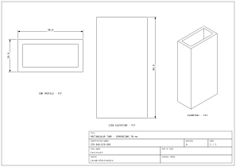
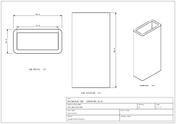

# Linear dimensions from native model geometry

`drawing_dimension` annotates one `drawing_part_view` with a vector dimension
line, extension lines, arrowheads, and a numeric label. A request selects either
named geometry provided by its source model or an inferred view extent. Values
come from that geometry in model mm; no independent numeric or text override can
drift from the model.

## Authoring intent

Dimensions nest under a part view. Use explicit boolean presets for the overall
size of its selected geometry:

```tsx
<assembly.drawing.partview
  partRef=".tube"
  name="end"
  direction="z+"
  width="90mm"
  height="90mm"
>
  <assembly.drawing.dimension widthOfView offset="10mm" precision={1} />
  <assembly.drawing.dimension heightOfView offset="10mm" />
</assembly.drawing.partview>
```

For a particular feature, reference a named edge actually provided by the model:

```tsx
<assembly.drawing.partview
  partRef=".tube"
  name="rounded-end"
  direction="z+"
  width="90mm"
  height="90mm"
>
  <assembly.drawing.dimension widthOfView offset="10mm" />
  <assembly.drawing.dimension
    edgeRef=".tube > .outer_top"
    orientation="horizontal"
    offset="23mm"
  />
</assembly.drawing.partview>
```

Select exactly one of `edgeRef`, `widthOfView`, or `heightOfView`.
The booleans request inferred extents, not imaginary named edges; an arbitrary
`overall_width` string is not a bounds request. Props #953 rejects conflicting
targets and explicit orientation with a true view preset. False booleans do not
select a target. Core registration, selector resolution, and dimension emission
remain future integration work. The exporter reads resolved Circuit JSON and
does not interpret TSX selectors.

## Native geometry ownership

Edges are not defined as endpoint pairs in drawing configuration or modelprinter.
A source model owns its native geometry and names: a JSCAD path can contain lines
and arcs, STEP can carry topology and native labels, and glTF producers can carry
named geometry metadata. There is no universal topology schema here, and mesh
indices do not automatically become stable edge names. STEP and glTF reader
adapters remain follow-up work.

The first implementation uses JSCAD geometry from jscad-electronics:

```ts
import {
  createRectangularTubeModel,
  listJscadNamedEdges,
  readJscadNamedEdge,
} from "jscad-electronics";

const tube = createRectangularTubeModel({
  width: 40,
  height: 20,
  wallThickness: 3,
  length: 80,
  outerRadius: 3,
});

// tube.geometry is the native Geom3 solid.
// tube.namedEdges owns native Geom2/Path2 features such as outer_top/outer_profile.
const names = listJscadNamedEdges(tube);
const top = readJscadNamedEdge(tube, "outer_top");
const profile = readJscadNamedEdge(tube, "outer_profile");
```

`createRectangularTubeModel` returns
`{ geometry: Geom3, namedEdges: Record<string, Geom2 | Path2> }`.
The readers operate on those model-owned objects. `outer_top` is the straight
feature between rounded-corner tangencies, measuring `40 - 2 × 3 = 34`mm.
`outer_profile` is the closed rounded contour spanning the actual 40mm width.
No artificial 40mm envelope edge is created to make the feature length agree with
the overall width.

The JSCAD model and reader use model-local right-handed CAD XYZ in mm, +Z up.
Modelprinter continues to own parameter strings, schemas, defaults, dimensions,
and validation; it does not duplicate named edge geometry. Its earlier endpoint
metadata proposal (#121) is superseded by model-native geometry ownership.

## Circuit JSON associations

An edge request records only the owning model and its opaque native name:

```ts
{
  type: "drawing_dimension",
  drawing_dimension_id: "end_top_feature",
  drawing_part_view_id: "end",
  measurement: "edge",
  cad_component_id: "cad_tube",
  edge_name: "outer_top",
  orientation: "horizontal",
  offset: 23,
  precision: 1,
}
```

The referenced CAD component already describes how to obtain and place its model.
The dimension does not duplicate the edge's shape, curve, endpoints, or topology.

An inferred extent references only the part view:

```ts
{
  type: "drawing_dimension",
  drawing_dimension_id: "end_width",
  drawing_part_view_id: "end",
  measurement: "view_width",
  offset: 10,
  precision: 1,
}
```

`measurement` is `edge` (default), `view_width`, or `view_height`. Edge mode
requires `cad_component_id` and `edge_name`; view presets forbid those fields.
Presets normalize orientation to horizontal for width and vertical for height.
Canonical Circuit JSON may retain the matching orientation; a conflicting one is
invalid. Presets produce no named edge record.

For an edge request, the owning CAD record must exist and its source component
must belong to the view's selected source components/group. If both selection
fields are supplied, both constraints apply. Duplicate IDs, missing owners,
missing views, and out-of-selection owner references are errors. Unknown native
names or unsupported native geometry must be rejected by the model reader rather
than replaced with inferred bounds.

## Reading model geometry

`DrawingOptions.resolveModelEdge(dimension, view, input)` may return synchronously
or asynchronously. It resolves the owning model and samples that named geometry
for projection:

```ts
const svg = await convertCircuitJsonToDrawingSvg(circuitJson, {
  resolveScene: () => tubeScene,
  resolveModelEdge: (dimension) => {
    if (dimension.cad_component_id !== "cad_tube") {
      throw new Error("The requested model is not loaded");
    }
    // This example's model placement is identity, so local CAD points are world points.
    return readJscadNamedEdge(tube, dimension.edge_name!);
  },
});
```

The callback result is `{ points: readonly { x, y, z }[], closed: boolean }`.
This is a temporary sampling adapter for renderer use, outside Circuit JSON;
it is not the model's topology definition. Curves remain native to the model.
The adapter must supply finite CAD world-space points in mm (+Z up) after the
same instance scale, rotation, and translation used by the rendered model. It
must report whether the path is closed. The exporter converts CAD points to
glTF +Y-up for projection and does not reapply the model's placement. Cache model
loading and native reader results in the caller when several dimensions share a
model.

Horizontal and vertical dimensions measure the full sampled path's span on the
camera's right/up axes. A closed `outer_profile` therefore measures 40mm wide;
using only its first and last point would incorrectly collapse a closed contour.
For this initial linear annotation, aligned dimensions accept only a straight,
open edge. Closed paths and noncollinear curves must fail rather than silently
turning into an endpoint chord. Radius, diameter, arc-length, and angular
annotations remain future work.

## Measurement and paper layout

- `aligned` measures a supported straight edge's true 3D length, including in an
  isometric view; its dimension line follows the projected edge.
- `horizontal` and `vertical` measure the native geometry's span along the view's
  orthonormal right/up model axes, using all sampled points.
- `view_width` and `view_height` measure the selected rendered geometry after
  model/world transforms. Section views use retained cut geometry. Viewport size,
  paper scale, and raster allocation do not supply the measured value.
- `offset` defaults to 8 signed paper mm. Positive follows the left normal in
  paper +Y-up coordinates: horizontal above, vertical left. Negative inferred
  offsets choose the bottom or right bounding side. Aligned edges retain native
  direction. Zero is allowed.
- `precision` defaults to 1 and accepts integer decimal places 0–6. Values are
  shown in model mm.

Annotations use the same camera as the PoppyGL raster, including auto-fit,
explicit scale, sections, and nonzero world placement. Model values remain
independent of paper scale and raster resolution: a 40mm extent still labels
40.0 at 1:1 or 1:2. End-on edges, zero extents, numerical overflow, and annotation
geometry extending outside the page are errors. Arrowheads, strokes, and text
retain physical paper sizes; short spans use outside arrows and a leader.
Automatic collision avoidance, diameter/radius and angular annotations,
tolerances, and certified drafting styles remain follow-up work.

## Demonstrations

The sharp 40 × 20 × 80mm tube uses width/height presets for its overall end and
side dimensions. Its isometric and section views come from the same native model.
The rounded profile with `outerRadius = 3`mm demonstrates the distinction between
a real 34.0mm `outer_top` feature, a 40.0mm closed native `outer_profile` span, and
an inferred overall width of 40.0mm. A section at Z=40 retains a 40.0mm side-view
height. Tests also exercise changed parameters, world placement, scale, invalid
references, unsupported curves, short spans, signed offsets, and page bounds.
The companion jscad-electronics tests inspect the native model/paths; these SVGs
inspect the rendered drawing annotations:





References: [Autodesk linear dimension guide](https://help.autodesk.com/cloudhelp/2025/ENU/AutoCAD-MAC-Core/files/GUID-42FD07E0-B6D8-4BCD-A621-EDDC94B8864B.htm)
and [FreeCAD TechDraw length dimensions](https://github.com/FreeCAD/FreeCAD-documentation/blob/main/wiki/TechDraw_LengthDimension.md).
These provide conventional drafting terminology; this implementation does not
claim complete ISO/ASME drafting compliance.

The native feature reader and its four-view model snapshot are proposed in
[jscad-electronics #504](https://github.com/tscircuit/jscad-electronics/pull/504).
